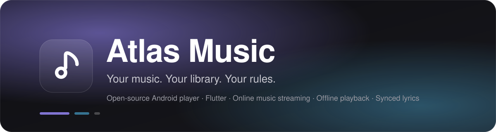
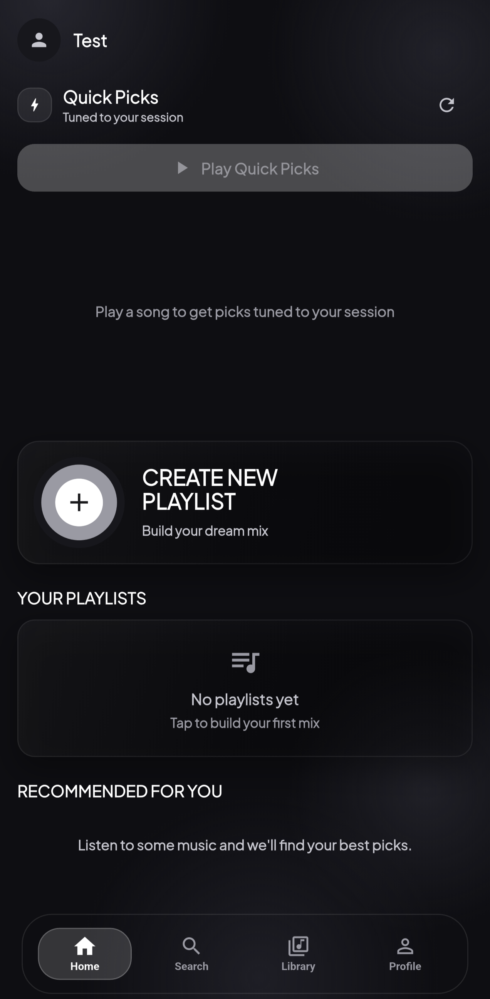
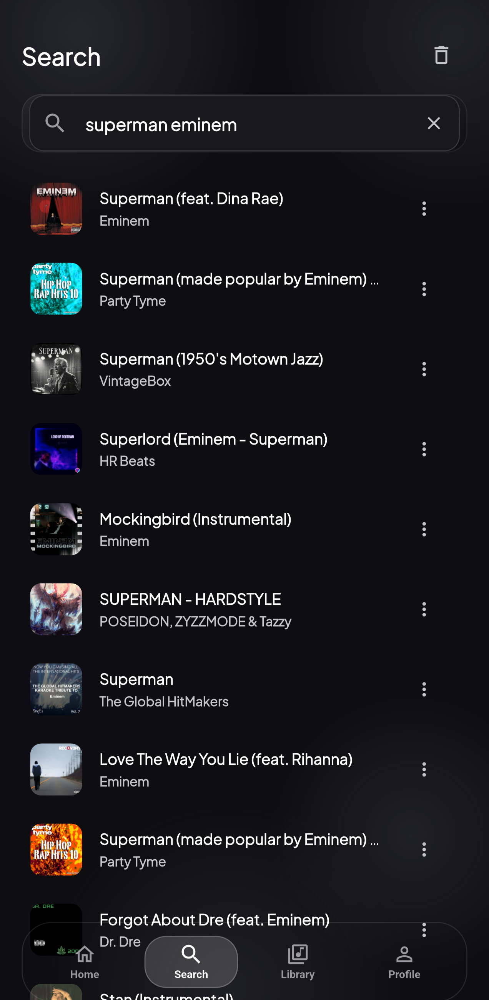
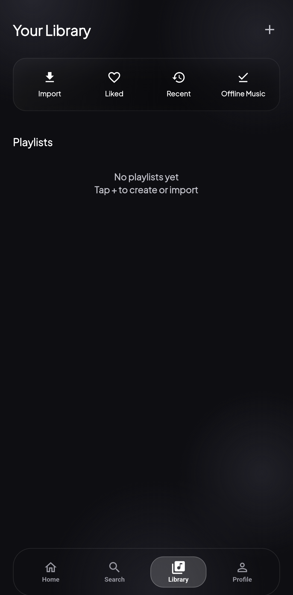
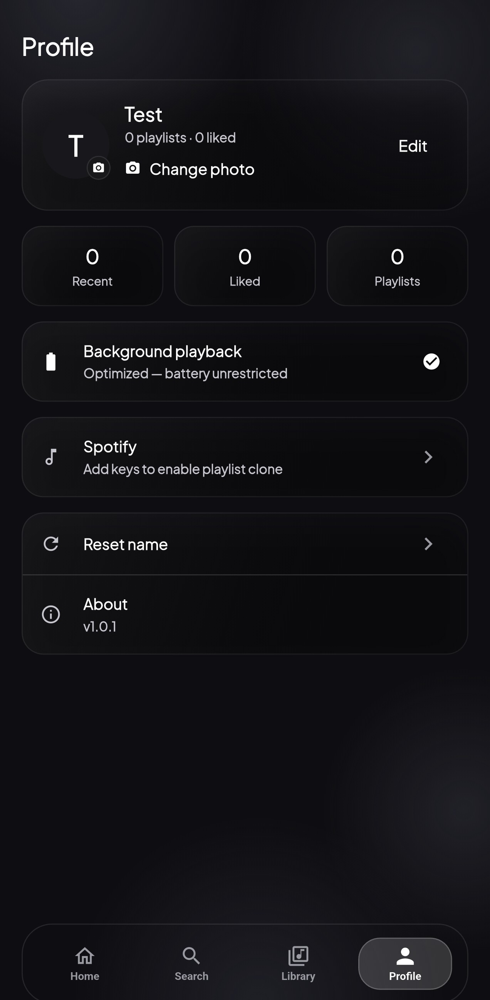
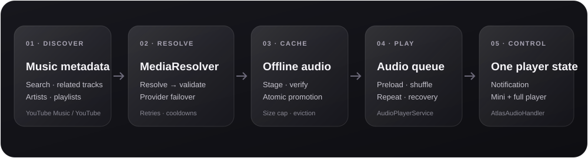

<div align="center">



<h1>Atlas Music</h1>

**A free, open-source Android music player built with Flutter.**<br />
Search YouTube Music, build playlists, follow synced lyrics, and keep listening offline — in a dark liquid-glass interface with real background playback.

<br />

<a href="https://github.com/myLastNeuron/Atlas-Music/releases/latest/download/Atlas.Music.apk"></a>

<br />

<p>
  <a href="https://flutter.dev"></a>
  <a href="https://dart.dev"></a>
  
  
  <a href="LICENSE.md"></a>
  <a href="https://github.com/myLastNeuron/Atlas-Music/actions/workflows/ci.yml"></a>
</p>

**[Screenshots](#screenshots) · [Features](#features) · [Install](#install) · [Build from source](#build-from-source) · [Architecture](#architecture) · [Data and privacy](#data-and-privacy) · [Contributing](#contributing)**

</div>

> [!IMPORTANT]
> **Android only.** This repository has no iOS project and does not support iOS builds. The app requires **Android 7.0 (API 24) or newer**.

---

## Screenshots

<table align="center">
  <tr>
    <td align="center"><strong>Home</strong><br /><a href="docs/media/home.png"></a></td>
    <td align="center"><strong>Search</strong><br /><a href="docs/media/search.png"></a></td>
  </tr>
  <tr>
    <td align="center"><strong>Library</strong><br /><a href="docs/media/library.png"></a></td>
    <td align="center"><strong>Profile</strong><br /><a href="docs/media/profile.png"></a></td>
  </tr>
</table>

---

## Features

### Playback

- Background playback with lock-screen artwork, and notification and headset controls. The notification and the in-app player share a single queue.
- Queue, shuffle, repeat, and "Play next". The upcoming track is preloaded and validated before it starts.
- Autoplay: when the queue runs out, Atlas explores related tracks, artist and title searches, and your liked or recently played music.
- Offline recovery: if a stream fails mid-play or connectivity drops, Atlas falls back to the cached copy and resumes the same song rather than skipping.
- Playback position is not restored after the app restarts (see [Current limits](#current-limits)).

### Discovery

- Search merges YouTube Music "Songs" results with plain YouTube video results, so slowed, reverb, remix, cover, lyric and sped-up uploads are reachable.
- A content filter removes non-music and long-form entries (trailers, movies, TV, podcasts, interviews) and results with an unknown duration. Songs already in your library and downloaded files are never removed by it.
- "Recommended for you" fills to 15 songs from your taste pool: a strict pass first, then a relaxed pass (personal-signal gate and per-artist cap loosened) when the pool is too small.
- Quick Picks are computed on-device from your listening history, with diversity controls and a one-line explanation for each pick.
- Artist pages, related tracks, and read-only video engagement statistics. YouTube does not publish dislike counts, so unavailable values show as `N/A`.

### Library

- Liked songs, recently played, listening history, and offline music as separate browsable collections.
- Create and edit playlists, add songs from search, change or remove covers, and download an entire playlist for offline listening.
- A playlist that still contains downloads is protected from deletion, and the UI says so instead of closing silently.

### Lyrics

- Synced, line-by-line lyrics from [LRCLIB](https://lrclib.net/) — no API key, no account.
- Tap any line to seek to it, and translate the displayed lyrics from the player (Google Translate).
- The lyrics cache is keyed on the full artist and title, so two songs by the same artist never share an entry.

### Playlists and import

- Import YouTube and YouTube Music playlists.
- Match a Spotify playlist to playable tracks using **your own** Spotify API credentials, entered in Profile and stored on the device.
- Or paste a plain track list and let Atlas match it.
- **Share a playlist as a QR code:** a playlist's menu has *Share Playlist*, which encodes the name and every track into a QR code (long playlists are split into several numbered codes that cycle on screen) and shares it as an image through any app.
- **Import Atlas Music Playlist:** Library → Import reads such a code with the camera or from a saved photo and clones the playlist locally. The clone is an ordinary editable playlist. No account, no server, no network.

### Find song and Auto listen

- **Find song** records roughly six seconds of the music around you, fingerprints it, and names the track. From the result you can play it or add it to a playlist. It is also available as a Quick Settings tile.
- **Auto listen** keeps identifying songs in the background while you use other apps. Start it from Profile, its Quick Settings tile, or the launcher long-press shortcut.
- Every match is appended to **Auto song fetch history** in Profile with an exact timestamp, grouped by Today/Yesterday. Rows behave like the rest of the library: tap to play, use the 3-dot menu to remove an entry, or clear the whole list.
- Identification uses Shazam's public fingerprint endpoint through the [`shazam_identifier`](https://pub.dev/packages/shazam_identifier) helpers; the match is resolved to a playable track with the same YouTube search the rest of the app uses.
- Recording never takes audio focus, so identifying a song does not pause what is already playing.

### Look and feel

- Dark liquid-glass surfaces, an animated ambient backdrop, and a floating navigation bar.
- The mini-player cover flies into the full player as a shared-element (Hero) morph.
- Settings: light mode, artwork-derived player colour, and a transparency slider (transparent to translucent, default halfway) that applies to every glass surface.
- Version label comes from the platform through `package_info_plus`, so it cannot drift from `pubspec.yaml`.

### Updates

- **Profile → Check for updates** reads the newest published GitHub Release, compares its tag with the installed version, shows what changed, downloads the APK and hands it to the Android installer. No server and no API key.
- Network failures are reported as "could not reach GitHub", distinct from "you are on the latest version", and a stalled download times out without leaving a partial file.

---

## Install

1. Download the latest signed APK from the [Releases page](https://github.com/myLastNeuron/Atlas-Music/releases/latest), or use the direct link: **[Atlas.Music.apk](https://github.com/myLastNeuron/Atlas-Music/releases/latest/download/Atlas.Music.apk)**.
2. Open the file on the device and allow installation from that source when prompted.
3. Launch Atlas. The first run asks for a display name and a few preferences, then builds your home screen.

After that, updates install in place from **Profile → Check for updates**.

---

## Build from source

### Requirements

| Tool | Version |
|---|---|
| Flutter | stable channel (developed with 3.47.2) |
| Dart | 3 |
| Android | 7.0 (API 24) or newer on the target device |
| Tooling | Android Studio, or Android SDK + JDK |

### Run

```bash
git clone https://github.com/myLastNeuron/Atlas-Music.git
cd Atlas-Music
flutter pub get
flutter run
```

> [!NOTE]
> `audio_service` is vendored at `plugins/audio_service` and wired in through a `dependency_overrides` entry in `pubspec.yaml`. Keep it in place or Android builds will lose their media session.

### Build an APK

```bash
# Universal APK
flutter build apk --release

# Smaller per-architecture APKs
flutter build apk --release --split-per-abi
```

Output goes to `build/app/outputs/flutter-apk/`.

### Sign a release

Without a signing configuration, release builds fall back to the machine's debug keystore. That is fine for local testing, but APKs signed on different machines cannot update each other. To publish update-compatible builds, create a private keystore:

```bash
keytool -genkey -v -keystore android/app/atlas-release.jks \
  -keyalg RSA -keysize 2048 -validity 10000 -alias atlas
```

Then create `android/key.properties` (both files are git-ignored):

```properties
storePassword=<your store password>
keyPassword=<your key password>
keyAlias=atlas
storeFile=atlas-release.jks
```

`android/app/build.gradle.kts` reads that file when it exists and uses the debug keystore otherwise.

> [!WARNING]
> Back up the keystore and its passwords. If you lose them, you cannot ship updates for existing installs.

### Publish an update

The in-app updater reads the newest **published** GitHub Release and compares its tag to the installed version, so a release *is* the update:

1. Bump `version` in `pubspec.yaml` (for example `2.1.0+9`).
2. Tag it to match and push:
   ```bash
   git tag v2.1.0
   git push origin v2.1.0
   ```
3. The `Release` workflow builds the signed APK and attaches it as `Atlas.Music.apk`.

Add these repository secrets once under **Settings → Secrets and variables → Actions**: `KEYSTORE_BASE64` (base64 of the `.jks`), `KEYSTORE_PASSWORD`, `KEY_ALIAS`, `KEY_PASSWORD`. The workflow refuses to publish a debug-signed APK and fails when the tag does not match `pubspec.yaml`.

> [!IMPORTANT]
> The tag must match `pubspec.yaml`, and the release must be **published, not a draft** — drafts are invisible to the updater. Existing installs were debug-signed, so the **first** release under the permanent key needs a one-time uninstall/reinstall. That wipes on-device data, because the app sets `allowBackup="false"`. Every update after that installs in place.

---

## Architecture

<div align="center">

</div>

| Step | Component | Responsibility |
|:-:|---|---|
| 1 | `YouTubeService` | Search, related tracks, artist data, playlist imports |
| 2 | `MediaResolver` · `ResolverStrategy` | Find and validate playable streams; provider order, retries, cooldowns |
| 3 | `CacheService` | Stage downloads, validate them, promote atomically, enforce the cache limit |
| 4 | `AudioPlayerService` | Queue, shuffle and repeat, preloading, offline recovery, downloads |
| 5 | `AtlasAudioHandler` | Bridge playback to Android media controls; screens follow shared state |

The resolver is the interesting part. `YouTubeProvider` asks several YouTube player clients in sequence, each with a 10 second budget inside a 25 second total, so a slow or consent-gated path (for example on UK IPs) fails over instead of stalling. Resolved manifests are cached for 20 minutes, each candidate stream is validated before it is handed to the player, and a failing provider enters a cooldown instead of being retried on every tap.

Downloads are staged to a temporary file, rejected if the body is implausibly small or the content type is wrong, and only then promoted into the cache atomically — a truncated download can never be mistaken for a playable file.

### Tech stack

- **App:** Flutter and Dart with Provider for state
- **Audio:** `just_audio`, `audio_session`, vendored `audio_service`
- **Metadata and streams:** YouTube Music / InnerTube and `youtube_explode_dart`
- **Lyrics:** LRCLIB; Google Translate for lyric translation
- **Local data:** `shared_preferences` and on-device files
- **Identification:** `record` and `shazam_identifier`
- **UI:** Plus Jakarta Sans, custom liquid-glass surfaces, and motion

### Project map

```text
lib/
├── main.dart, app.dart     # Startup, providers, navigation shell
├── media/                  # Resolver contract, provider chain, offline cache
├── models/                 # Song, playlist, artist, video stats
├── screens/                # Home, search, library, player, profile, …
├── services/               # Playback, YouTube, lyrics, storage, identify, recommendations
├── theme/                  # Colours, typography, motion, shared theme
└── widgets/                # Mini-player, lyrics, artwork, glass navigation
plugins/audio_service/      # Vendored audio_service Android implementation
docs/media/                 # Screenshots and architecture diagram
```

---

## Data and privacy

Atlas has no accounts, no cloud sync, and no analytics. Everything below stays on the device:

- Playlists, liked songs, history, preferences, and the display name.
- Downloaded audio in the app cache.
- Spotify credentials, if you choose to enter them for playlist matching.
- Auto listen history.

The cache is capped at **1 GB** with a **30-day TTL**. Eviction is oldest-first, and files belonging to the currently playing queue are never evicted. The app sets `allowBackup="false"`, so Android will not copy this data into a device backup.

### Android permissions

| Permission | Why |
|---|---|
| `INTERNET`, `ACCESS_NETWORK_STATE` | Search, stream resolution, lyrics, updates |
| `WAKE_LOCK`, `FOREGROUND_SERVICE`, `FOREGROUND_SERVICE_MEDIA_PLAYBACK` | Playback with the screen off |
| `POST_NOTIFICATIONS` | Playback and Auto listen notifications |
| `REQUEST_IGNORE_BATTERY_OPTIMIZATIONS` | Optional prompt so background playback is not killed by the system |
| `RECORD_AUDIO`, `FOREGROUND_SERVICE_MICROPHONE` | Find song and Auto listen |
| `CAMERA` | Scanning a shared playlist QR code |
| `REQUEST_INSTALL_PACKAGES` | Handing a downloaded update to the Android installer |

---

## Checks

```bash
flutter analyze
flutter test
```

GitHub Actions runs both on every push and pull request. `flutter analyze` is expected to be clean; the vendored `plugins/audio_service` copy is excluded from analysis. The test suite covers content filtering, recommendations, cache and download policy, resolver failover and cooldowns, lyrics and translation, playlist parsing, playlist QR generation and decoding, Spotify matching, storage, song identification, the update service, and UI behaviour such as motion and queue handling.

---

## Current limits

- Android only. iOS support has not started.
- No queue-reordering screen, and playback position is not restored after the app restarts.
- No cloud sync or user accounts; library data stays on-device.
- The dark appearance is the default look; light mode is available, and there is no separate accent-colour picker.
- One-shot **Find song** needs Atlas on screen, because Android only grants the microphone to a visible app and there is no "always allow" option. **Auto listen** covers background listening, but it must be started from Atlas (tile or shortcut) and uses more battery.
- YouTube does not publish dislike counts, so those values show as `N/A`.
- Playlist QR codes are size-limited by QR capacity; long playlists need several codes, which are shared together in one image.

---

## Contributing

1. Fork the repository and create a branch.
2. Make your change and add or update tests where they apply.
3. Run `flutter analyze` and `flutter test`.
4. Open a pull request with a short description and your test results.

Issues and pull requests are welcome. Keep platform claims accurate: **Android is the only supported target today.**

---

## License and disclaimer

Atlas Music is licensed under the [Apache License 2.0](LICENSE.md).

> [!CAUTION]
> This is a mostly AI-generated learning project and has **not** had a formal security audit. It is provided without warranty. YouTube's Terms of Service may restrict direct audio extraction. Use the app responsibly, and follow the terms and laws that apply to you.

---

<div align="center">

**If Atlas Music is useful to you, consider giving the repository a star.**

Built with Flutter, for the love of music.

</div>
